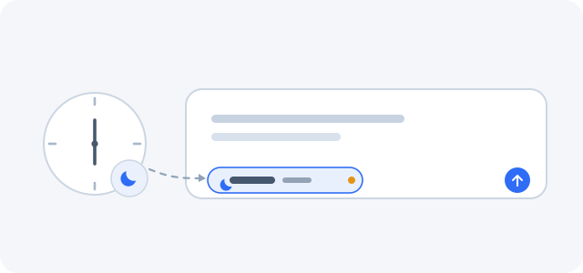

# Off-peak run · 谷时执行

**English** | [简体中文](README.zh-CN.md)

[](https://github.com/StarDragonCN/dsh-offpeak-exec/actions/workflows/ci.yml)

A [DeepSeek Harness](https://github.com/deepseek-ai/dsh) (DSH) plugin that puts a switch next to the composer. While the switch is on, a message you send during **DeepSeek peak pricing** is held, and only starts when **off-peak rates** apply.

No model request is made while waiting, so waiting itself is free — and the same tokens cost roughly half once the clock reaches off-peak.



## Install

```text
npm install dsh-offpeak-exec
```

In DSH, add it from the plugins page (**Plugins → Add plugin**, enter `dsh-offpeak-exec`), or ask the agent to install it — the agent calls:

```text
plugin_manager action: "install_bundle" target: "dsh-offpeak-exec"
```

Either path installs the package from npm into the current profile and enables it as a bundle. Refresh the Web page afterwards; the switch appears in the composer tool row, on the left.

Installing from a local checkout works the same way — point `target` at the directory instead of the package name.

## Behavior

With the switch ON:

| Situation | Result |
| --- | --- |
| Currently off-peak | Runs immediately |
| Currently peak | The message appears in the conversation, but **no model request is made** until the next off-peak start (`12:00`, `18:00`, or `09:00` next workday) |
| You send another message while a task is running (peak) | Held the same way; tool-only continuation steps are never delayed |
| You press stop while waiting | The turn is cancelled and has to be sent again |
| You turn the switch off while waiting | The held message is released immediately and runs at peak price |

With the switch OFF, behavior is exactly as before.

Other details:

- The switch is **per conversation**. It survives a page refresh and keeps showing the right state when you switch sessions.
- After a Host restart the switch returns to off — status is not persisted, so you never believe you saved money when you did not.
- The longest wait is about 3 hours (`09:00 → 12:00` is the worst case).
- While waiting, the conversation shows a running state and the switch reads "Queued · runs at 12:00".

## Also without the mouse

```text
/offpeak          toggle the switch
/offpeak on       turn it on
/offpeak off      turn it off
/offpeak status   show state and the next off-peak time
```

## Where the peak hours come from

The rules are hard-coded in the plugin (`index.js` and `client.js` each carry a copy; the client one drives the countdown):

- Peak windows: Beijing time, workdays `09:00–12:00` and `14:00–18:00`.
- Public holidays count as off-peak; make-up workdays (调休) count as workdays. `HOLIDAYS_BY_YEAR` ships the full 2026 table.
- Years without a table fall back to a plain weekday check.

> That means **2027 needs its table added**, otherwise statutory holidays are treated as workdays. The table is updated once a year — pull requests welcome.

The pricing and window facts come from DeepSeek's official pricing page (`api-docs.deepseek.com`). If they move the windows, only the two hour ranges inside `isPeakBeijing` need to change.

## Development

No build step, plain ESM. `client.js` is loaded by the DSH frontend through `window.__ModuleLoader__`; `index.js` runs in the Host.

```bash
node --check index.js && node --check client.js
npm test        # three test files, no dependencies to install
```

Coverage: peak/off-peak and holiday edges (including a national holiday and a make-up workday), the Host gate (suspend, abort, mid-turn messages, release on switch-off), and the client render/click path (using a minimal React stand-in, not the real react).

Host-side changes (`index.js`) need a DSH restart; client changes (`client.js`) only need a page refresh.

## Limitations

- The switch UI is Web-only; the Host command works in every frontend.
- Switch state is not persisted: a Host restart turns it off.
- Times are always computed in Beijing time (UTC+8), not the local time zone.

## License

MIT © StarDragonCN
