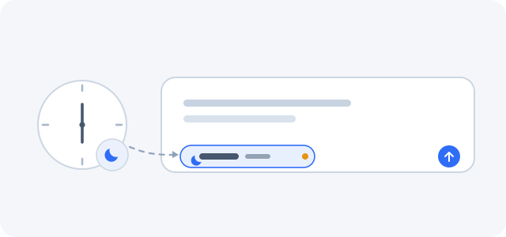

# 谷时执行 · Off-peak run

[English](README.md) | **简体中文**

[](https://github.com/StarDragonCN/dsh-offpeak-exec/actions/workflows/ci.yml)

一个 DeepSeek Harness（DSH）插件：在对话里加一个开关，把**高峰时段发出的消息**按住，等到**谷时**再真正发起请求。

因为等待期间不向模型发出任何请求，所以等待本身不花钱；同样的 token 在谷时只付约一半的价钱。



## 安装

```text
npm install dsh-offpeak-exec
```

在 DSH 里从插件页添加（**插件 → 添加插件**，填入 `dsh-offpeak-exec`），或者直接对 agent 说一句「安装 dsh-offpeak-exec」——agent 会调用：

```text
plugin_manager action: "install_bundle" target: "dsh-offpeak-exec"
```

两条路都会把包从 npm 装进当前 profile 并作为 bundle 启用。装完刷新 Web 页面，输入框左侧工具行就会出现「谷时执行」开关。

从本地目录安装也同样简单：把 `target` 换成插件目录的绝对路径即可。

## 行为

开关打开（ON）后：

| 情况 | 结果 |
| --- | --- |
| 当前处于谷时 | 消息立即执行 |
| 当前处于高峰 | 消息进入对话，但**不发起模型请求**，等到最近的谷时起点（`12:00`、`18:00` 或次日 `09:00`）自动开始 |
| 任务执行中你又发了一条（高峰期） | 同样按住，等到谷时；纯工具续跑的步骤不受影响 |
| 等待中你点「停止」 | 取消本轮，需重新发送 |
| 等待中你关掉开关 | 立刻放行，按高峰价现在执行 |

开关关闭（OFF）时行为与原生完全一致。

其它细节：

- 开关**按对话隔离**，只影响当前会话；刷新页面、切换会话后状态依然正确显示。
- Host 重启后开关回到关闭状态（不做持久化，避免你以为省了钱其实没有）。
- 等待最长约 3 小时（`09:00` 等到 `12:00` 是最坏情况）。
- 等待期间会话显示为「运行中」，按钮上会显示「已排队 · 12:00 自动执行」。

## 也可以不用鼠标

```text
/offpeak          切换开关
/offpeak on       打开
/offpeak off      关闭
/offpeak status   查看当前状态与下次谷时时刻
```

## 峰谷规则从哪来

规则硬编码在插件里（`index.js` / `client.js` 各一份，客户端那份用于显示倒计时）：

- 峰窗：北京时间工作日 `09:00–12:00`、`14:00–18:00`。
- 法定假日按谷时计，调休补班日按工作日计；`HOLIDAYS_BY_YEAR` 里内置了 2026 年全年的放假/补班表。
- 表外年份回退到自然周末判断（`周一到周五` 视为工作日）。

> 也就是说：**2027 年需要补表**，否则法定假日会被当成工作日。节假日表每年更新一次，欢迎 PR。

定价与时段的事实来源是 DeepSeek 官方定价页（`api-docs.deepseek.com` 的分时计价说明）。如果官方改了峰窗，改 `isPeakBeijing` 里那两行区间即可。

## 开发

无构建步骤，纯 ESM。`client.js` 由 DSH 前端用 `window.__ModuleLoader__` 加载，`index.js` 跑在 Host。

```bash
node --check index.js && node --check client.js
npm test        # 用 node 跑三个测试，无需装依赖
```

测试覆盖：峰谷/假日边界（含国庆、调休补班）、Host 门禁（挂起、abort、轮内插话、关闭放行）、客户端渲染与点击链路（用极简 React 替身，不依赖真实 react）。

改 Host 侧代码（`index.js`）需要重启 DSH 才生效；改客户端（`client.js`）刷新页面即可。

## 限制

- 只在 Web 端有开关；Host 侧命令在任何前端都可用。
- 开关状态不做持久化，Host 重启即关闭。
- 时区固定按北京时间（UTC+8）计算，不跟随本机时区。

## License

MIT © StarDragonCN
